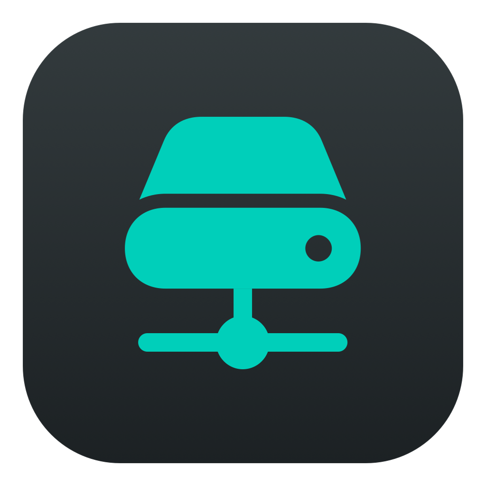
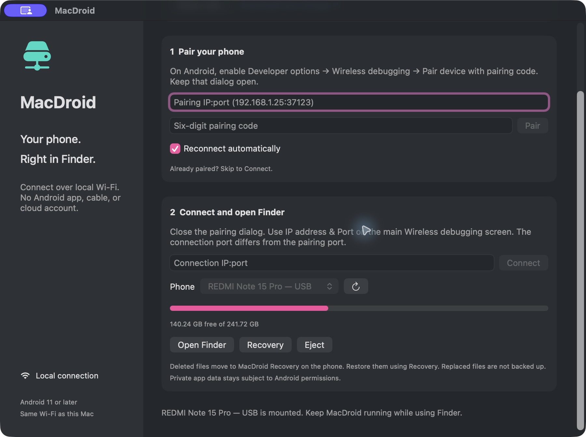

<p align="center">
  
</p>

# MacDroid

**Your Android phone, right in Finder.**

MacDroid is a native macOS app for browsing and managing Android files over **USB or local Wi-Fi**. Mount your phone's shared storage in Finder, then copy files in either direction, create folders, rename items, and recover files deleted through MacDroid.

No Android app, cloud account, or internet connection is needed for file transfers.

[Download for Apple Silicon](https://github.com/ZeltaStudio/MacDroid/releases/latest) · [Changelog](CHANGELOG.md) · [Report a bug](https://github.com/ZeltaStudio/MacDroid/issues/new/choose)

[](https://github.com/ZeltaStudio/MacDroid/actions/workflows/build.yml)



## Features

- **Finder integration** — manage phone files using familiar Finder windows and drag and drop.
- **Faster previews** — Finder and Quick Look thumbnails for photos and videos reuse a short cached read, which matters most on Wi-Fi. Opening a file still transfers the complete contents.
- **USB and Wi-Fi** — use an authorized USB debugging connection or Android Wireless debugging.
- **Automatic reconnect** — remember your phone and reconnect when it becomes available. The connection follows the same physical phone across supported transport changes.
- **Readable device names** — distinguish USB and Wi-Fi connections in the device picker and menu.
- **Transfer controls** — see progress, speed, and estimated time for each transfer stage, or cancel an active transfer.
- **Recoverable deletion** — deleted files move to a protected recovery folder on the phone. Restore them to their original location without replacing an existing item.
- **Menu bar access** — mount, open Finder, eject, access recovery, and manage reconnect without keeping the main window open.
- **Storage information** — check used space and available capacity on the phone.

## Requirements

| Component | Requirement |
| --- | --- |
| Mac | macOS 13 or later |
| Packaged installer | Apple Silicon (M-series) Mac |
| Wireless connection | Android 11 or later, Wireless debugging enabled, same local network |
| USB connection | USB debugging enabled, a data-capable cable, and authorization on the phone |
| Build tools | Xcode Command Line Tools with Swift 5.9 or later |
| Android connection tools | [Android SDK Platform Tools / ADB](https://developer.android.com/tools/releases/platform-tools) |

The packaged build is currently locally signed and **not Apple-notarized**. This is an early development release.

## Connect your phone

### Over USB

1. Enable **Developer options → USB debugging** on Android.
2. Connect your phone to the Mac and approve the debugging authorization prompt.
3. Open MacDroid, refresh the device list if needed, and select the **USB** entry.
4. Click **Open Android in Finder**.

### Over Wi-Fi

1. Connect your Mac and phone to the same Wi-Fi network.
2. Enable **Developer options → Wireless debugging** on Android.
3. Choose **Pair device with pairing code**. Enter that dialog's IP address, port, and six-digit code in MacDroid, then click **Pair**.
4. Close the pairing dialog. Enter the connection IP address and port from the main Wireless debugging screen, then click **Connect**. The connection port differs from the pairing port.
5. Select the **Wi-Fi** entry and click **Open Android in Finder**.

Already paired? Skip pairing and connect directly. Automatic discovery depends on your local network; manual IP:port entry remains available.

**Keep MacDroid running while using the mounted volume.** Finish or cancel transfers, then use **Eject** before disconnecting your phone.

## Recover a deleted file

Open **Recovery** from the main window or menu bar, select an item, and click **Restore**. MacDroid restores it to its original location only if that location is available and no item would be overwritten.

Recovered deletions remain on the phone and continue using storage until restored. There is currently no automatic expiry or permanent-empty command. Files overwritten by transfers, and files deleted outside MacDroid, are not backed up by this feature.

## Install

Download the DMG from the [latest release](https://github.com/ZeltaStudio/MacDroid/releases/latest), quit any running copy, and drag **MacDroid.app** into **Applications**. The release includes ADB and a SHA-256 checksum. Saved preferences are preserved.

If images appeared incomplete in an older version, update to **0.2.2 or later**, eject the old phone mount, and remount before reopening the images. Finder and Preview can cache earlier partial previews.

## Build from source

```sh
git clone https://github.com/ZeltaStudio/MacDroid.git
cd MacDroid
./scripts/build-app.sh release
```

Open `dist/MacDroid.app`, or build a drag-to-Applications installer:

```sh
./scripts/package-dmg.sh
```

The installer is written to `dist/MacDroid-<version>-macos-arm64.dmg`. Open it and drag **MacDroid.app** onto **Applications**. Quit any running copy before replacing it; your saved preferences are preserved.

The build embeds ADB if it is available at `.build/downloads/platform-tools/adb`. Otherwise, install Google's Platform Tools separately and use **Select adb…** in MacDroid. Common Android SDK and Homebrew installation locations are also detected. Bundled tools retain their vendor notices.

For a development build, run `swift build` or `./scripts/build-app.sh debug`.

## How it works

```text
Finder ↔ local WebDAV bridge ↔ ADB ↔ Android shared storage
```

The SwiftUI app pairs with Android using ADB and exposes shared storage (`/sdcard`) through macOS's built-in WebDAV filesystem. The bridge listens only on `127.0.0.1` and uses a random per-session URL. No filesystem driver or system extension is required.

Android's access restrictions still apply. MacDroid does not expose protected system files or other apps' private data.

## Current limits

- Reconnecting restores access to the phone; it does not resume interrupted file transfers.
- Progress and remaining-time estimates apply to the displayed transfer stage, not an entire folder operation.
- Full-file downloads are staged on the Mac before delivery to Finder and need enough temporary disk space for a complete file. Thumbnail reads transfer a byte range plus a short read-ahead, then reuse it. Photos up to 8 MB are fetched once and cached. The bytes served are always the real file, including ranged reads.
- File operations are serialized; large directory listings can be slow, and Finder may cache older contents.
- Extended attributes, full macOS metadata preservation, and separately selectable SD-card storage are not supported yet.
- Finder may create `.DS_Store` and `._` metadata files. Its own free-space display may be unavailable; use the app's storage indicator.

## Verification and development

Run the standalone Swift checks without full Xcode or XCTest:

```sh
swift run MacDroidCheck
```

Optional checks exercise actual macOS mounting and an already-authorized Android phone. See the [development guide](docs/DEVELOPMENT.md#checks) for commands and details.

Checks cover transfer cancellation, deletion and restoration, traversal and overwrite protection, partial reads and complete JPEG reconstruction, real-phone transfers, Finder mounting/ejection, and routing between authorized USB and Wi-Fi connections on the same phone. Hardware checks are opt-in; standard checks run on pushes and pull requests through GitHub Actions.

See [the development guide](docs/DEVELOPMENT.md) for architecture, source layout, packaging, and icon generation.

## License

MacDroid's source code is available under the [MIT License](LICENSE). Bundled Android tools and icon resources retain their applicable licenses; see [third-party notices](THIRD_PARTY_NOTICES.md).
